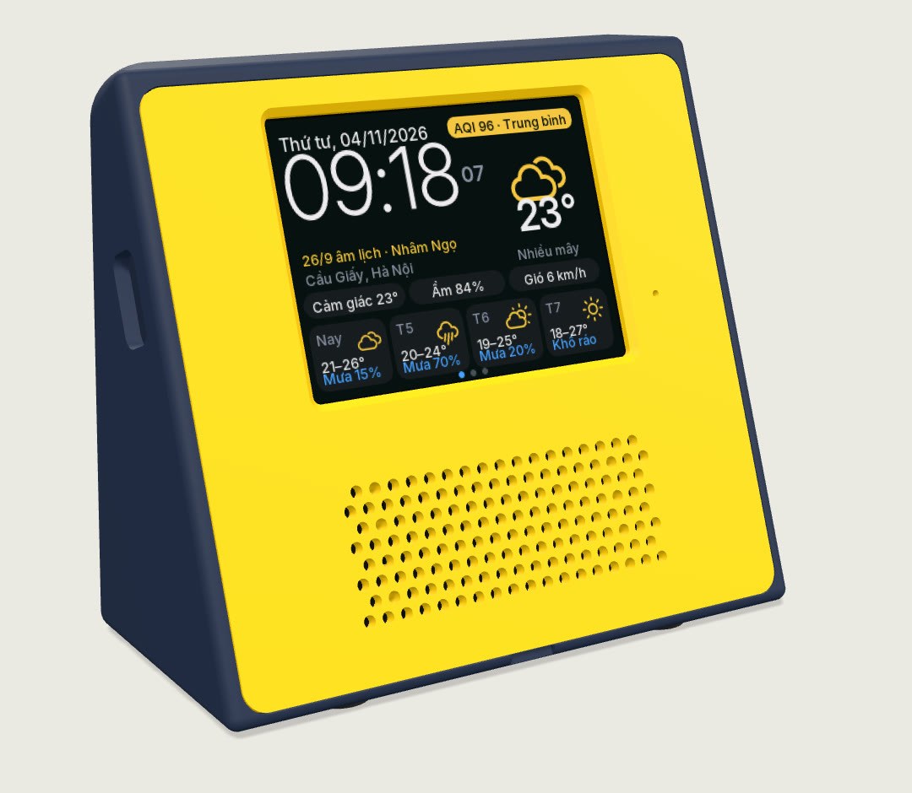
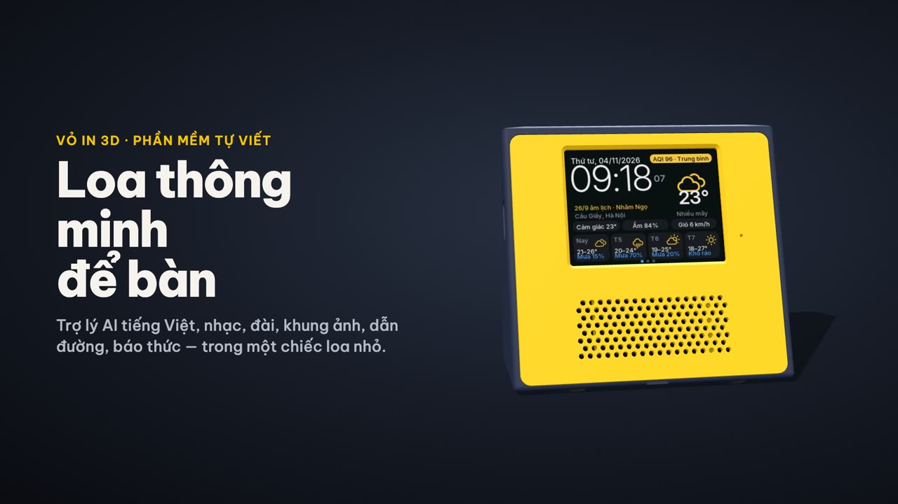
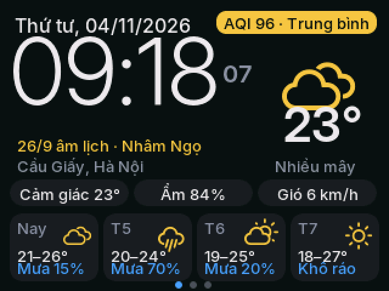
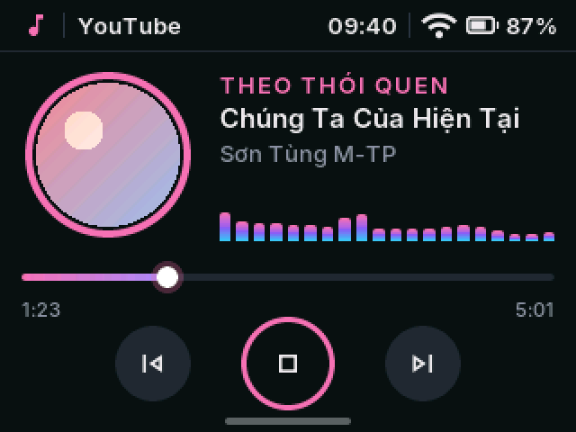
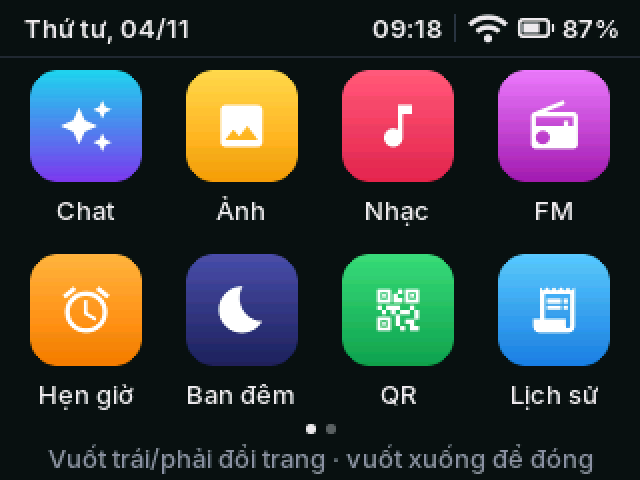

# Loa Ting

### Loa thông minh để bàn, vỏ in 3D

**Trợ lý AI tiếng Việt · Nhạc · Đài VOV · Khung ảnh · Waze HUD · Báo thức · Lịch âm · Báo biến động số dư**

---

**Loa Ting** là chiếc loa nhỏ có màn hình cảm ứng 2,8″, chạy trên mạch **LCDWIKI ES3C28P (ESP32-S3)**. Firmware dựa trên [Xiaozhi ESP32](https://github.com/78/xiaozhi-esp32), được viết lại giao diện tiếng Việt và thêm nhạc, đài, khung ảnh, Waze HUD, báo thức, lịch âm và báo biến động số dư. Vỏ in 3D gồm 5 chi tiết, in một lần trên máy in nhiều màu.

> Repo này chỉ chứa trang giới thiệu và các bản tải về. Mã nguồn để riêng tư.

## ▶️ Video giới thiệu

Video review gần 5 phút: vỏ in 3D, rồi từng ứng dụng trên loa. Xem tại **[esp32.viennv.dev](https://esp32.viennv.dev/#video)**.

## ✨ Tính năng

| | |
| --- | --- |
| 🤖 **Trợ lý AI “Hey Ivy”** | Gọi “Hey Ivy” rồi nói tiếng Việt tự nhiên: hỏi thời tiết, mở nhạc, mở đài, đặt báo thức, hẹn giờ. Chữ hiện ngay trên màn. |
| 🎵 **Nhạc theo yêu cầu** | Nói tên bài, loa tự tìm trên Zing MP3 hoặc YouTube rồi phát, có ảnh bìa và sóng nhạc. |
| 📻 **Đài trực tiếp** | VOV1, VOV2, VOV3, VOV Giao thông Hà Nội và TP.HCM, VOH. |
| 🖼️ **Khung ảnh** | Lúc rảnh, loa chiếu ảnh từ album Google Photos bạn chọn, kèm giờ và thời tiết. |
| 🚗 **Waze HUD** | Đặt trên xe: hướng rẽ, làn đường, tốc độ, biển giới hạn và cảnh báo camera, lấy từ Waze trên điện thoại. |
| ⏰ **Báo thức, đếm ngược** | Đặt bằng tay hoặc bằng giọng nói, lặp theo thứ, 10 âm báo có sẵn. |
| 🌤️ **Đồng hồ, thời tiết, lịch âm** | Giờ to, chất lượng không khí, dự báo 4 ngày; lịch tháng có ngày âm, tiết khí, giờ tốt. |
| 🌙 **Ban đêm** | Màn hình tự dịu, chỉ còn đồng hồ to; thông báo được đọc thật nhỏ. |
| 💸 **Báo biến động số dư** | “Ting” rồi đọc số tiền vừa nhận, có mã VietQR và lịch sử giao dịch. |
| 📱 **Cài bằng điện thoại** | Quét mã trên loa để mở trang cài đặt. Không cần cài app. |

  
  
  

## 🧰 Phần cứng

- **Mạch LCDWIKI ES3C28P:** ESP32-S3, 16 MB flash, 8 MB PSRAM, Wi-Fi; màn IPS 2,8″ cảm ứng 320 × 240; codec ES8311, micro và loa đi kèm; khe microSD, đèn LED màu, USB-C sạc pin.
- **Vỏ để bàn:** 104 × 52 × 92 mm, mặt trước ngả 20°; pin 18650 dưới đáy, công tắc nguồn; mặt trước cài 4 nẫy móc, không cần vít; 9 khe thoát nhiệt sau lưng.
- **In 3D:** 5 chi tiết, khoảng 97 g nhựa, lưng xanh than hoặc đen, mặt trước vàng. File 3MF xếp sẵn bàn in 220 × 220.

## 📥 Tải về

Bản phát hành đầu tiên sẽ có ở trang **[Releases](https://github.com/small-project-mmo/loa-ting-releases/releases)**: firmware kèm công cụ nạp, và file in vỏ (3MF, STL, bản vẽ).

## 🛠️ Tự làm một chiếc

1. **In vỏ, chuẩn bị:** in 5 chi tiết từ file 3MF. Cần thêm mạch ES3C28P (kèm loa), một pin 18650 và một công tắc nhỏ.
2. **Nạp firmware:** cắm mạch vào máy tính bằng USB-C rồi nhấp đúp `nap-firmware.command` (hiện chạy trên macOS). Cập nhật về sau vẫn giữ Wi-Fi và cài đặt.
3. **Cài bằng điện thoại:** vào Wi-Fi “Xiaozhi-xxxx” của loa để chọn mạng nhà, rồi quét mã trên loa để mở trang cài đặt.

---

Một dự án của **[viennv.dev](https://viennv.dev)** · Trang giới thiệu: **[esp32.viennv.dev](https://esp32.viennv.dev)**

Ảnh màn hình chụp từ giao diện thật, dữ liệu giao dịch là dữ liệu mẫu. Ảnh vỏ dựng từ mô hình 3D.

